# DEEPSDR 101 — firmware abierto

> ### *In memory of Carlos EB4DYL*

**Firmware para el receptor DEEPSDR 101 (GD32F450VET6):** la
interfaz rehecha entera, veintiocho modos, un cargador de arranque propio y —
lo que de verdad sostiene todo lo demás — **un simulador que compila el código
de verdad del firmware en el PC**, de modo que casi cada decisión de este
repositorio se tomó midiendo y no a ojo.

> **Este firmware es totalmente gratuito, no se saca ningún beneficio
> económico de él. Además es totalmente reversible: cualquier usuario puede
> grabar este firmware y volver al firmware original en cualquier momento.
> No secuestramos ni bloqueamos ningún dispositivo.**

`V6.14` · cargador `v2.19` · **dos binarios, uno por chip**:
`update.bin` 487.916 B CRC `49AEF5F4` (GD32F450VET6, 512 kB) ·
`update_470.bin` 487.948 B CRC `9CB982C5` (GD32F470VGT6, 1024 kB) ·
**275 comprobaciones en verde, 0 fallos** (`make comprueba`)

🇬🇧 [English below](#deepsdr-101--open-firmware) · 📘
[Manual de uso (PDF, ES + EN)](DeepSDR_Reload_Manual-ES-EN.pdf)

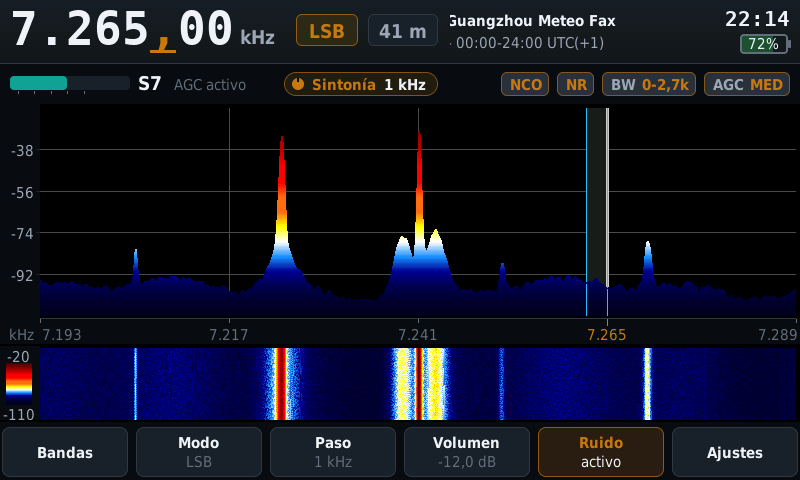

---

## Qué es esto

El DEEPSDR 101 es un receptor SDR de **30 kHz a 180 MHz** —onda media, onda
corta y VHF— con pantalla táctil de 800×480, mezclador QSD y un GD32F450VET6
como único procesador. Esto es **otro firmware** para esa placa: no un parche del de fábrica, sino un árbol propio,
sin RTOS y sin más HAL que la biblioteca estándar de GigaDevice.

Tres cosas lo resumen:

- **La interfaz está rehecha desde el motor de dibujo.** El original abría una
  ventana del panel por píxel; aquí se compone una banda de 16 filas en RAM y
  se vuelca de una vez. De eso salen las tipografías con antialias, las
  esquinas redondeadas y los degradados.
- **Hay veintiocho modos**, de AM a STANAG, pasando por FT8, HFDL, WSPR, AIS,
  SSTV, WEFAX, PSK31 y un modo IDENT que escucha una señal desconocida y
  **dice qué es**.
- **Hay un simulador** (`deepsdr-ui/`) que compila **los mismos ficheros** del
  firmware en el PC y saca PNG. No una copia: los ficheros. Un banco que mide
  una copia miente.

> **Esto no es un producto oficial ni lleva garantía de nadie.** Reemplaza el
> cargador de arranque de la radio. Hay una salida de emergencia a DFU
> (encender con el mando pulsado y girándolo) que ya ha rescatado la radio dos
> veces, pero si no estás dispuesto a asumir que la radio se quede muda, no lo
> grabes.

---

## Capturas

**Recibiendo RTTY de verdad** — el boletín meteorológico de DDH47, en 3.695 kHz,
decodificado en antena:

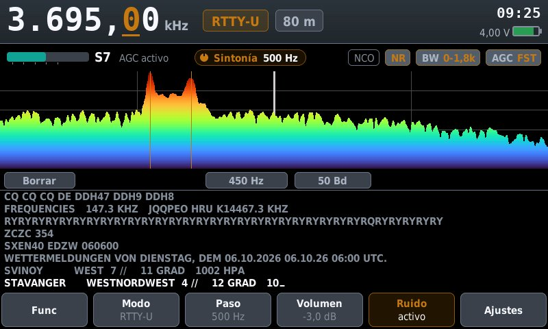

**FT8**, con la lista de lo oído —distancia y país por cada estación— y el mapa
con los indicativos y la línea desde tu QTH:

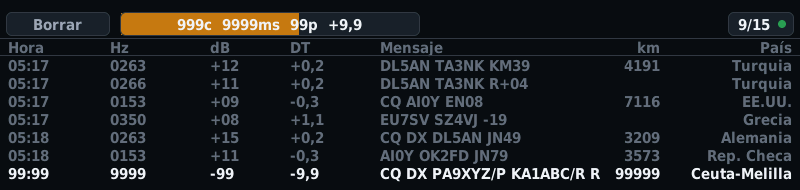

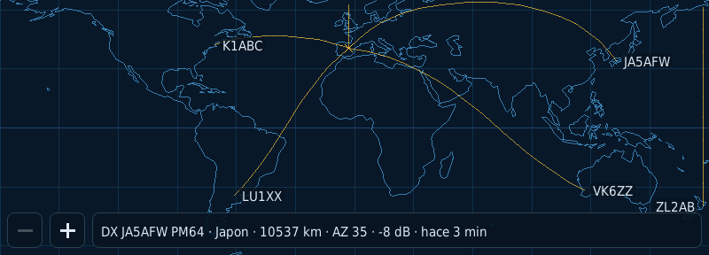

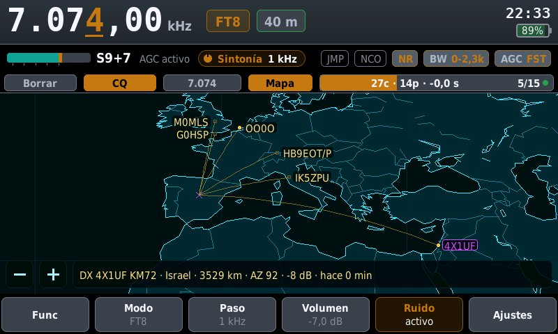

*El mapa rellena la tierra a todas las escalas desde la V5.04, y cada
indicativo lleva su ortodrómica desde el QTH. Arriba, junto a NCO, la pastilla
**JMP**.*

La barra del ciclo de 15 segundos lleva dentro los candidatos, el desfase medio
y el segundo de la ranura; tocarla cuadra el ciclo:

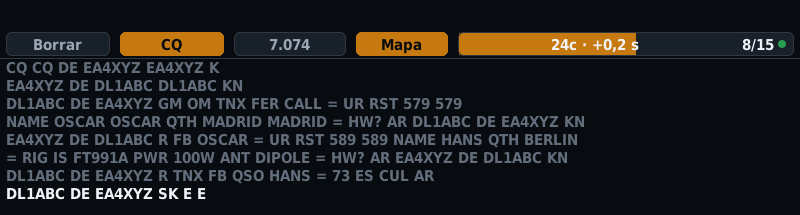

**HFDL** — datos de aviones en onda corta, con modelo de aparato, vuelo y
posición:

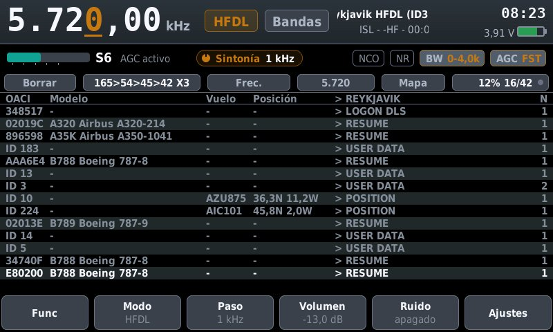

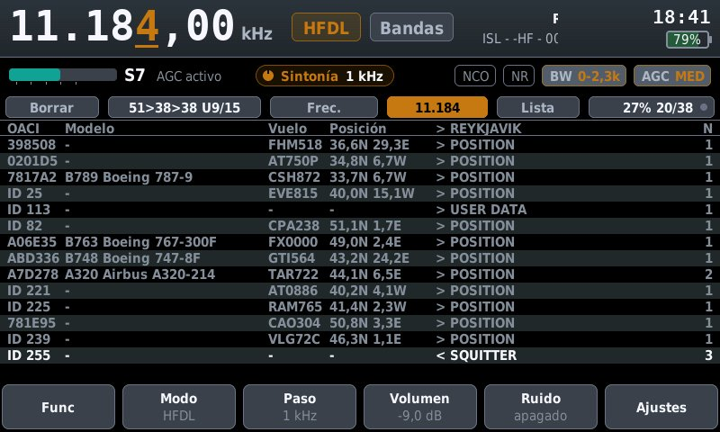

*11.184 kHz: dirección OACI, modelo, distintivo de vuelo y posición de cada
aparato. El modelo sale de la base de datos cuando el avión está fichado; el
que no lo esté lleva un guión.*

**STANAG 4285**, enganchado sobre una emisión naval real:

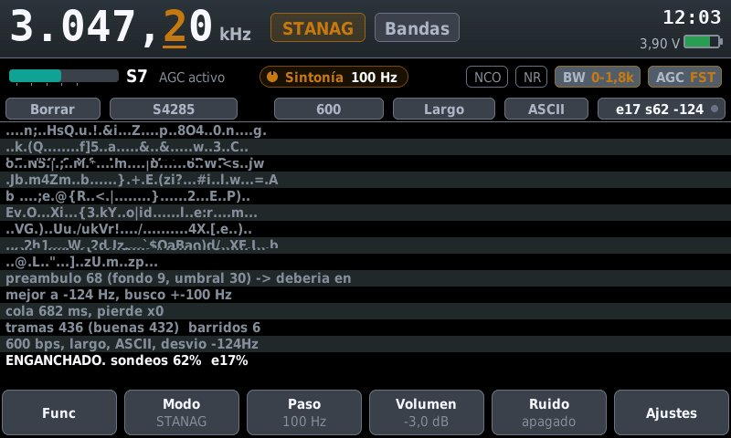

**IDENT** — «¿qué señal es ésta?». Mide ancho, tonos, separación, velocidad de
símbolo, periodo de trama y cadencia, y lo convierte en un nombre:

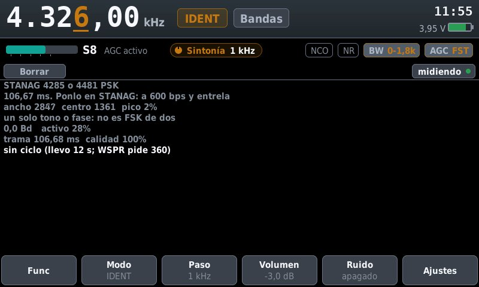

El menú de modos, las bandas, los ajustes y el teclado de frecuencia:

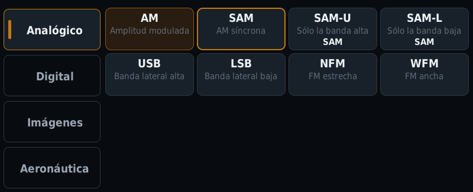

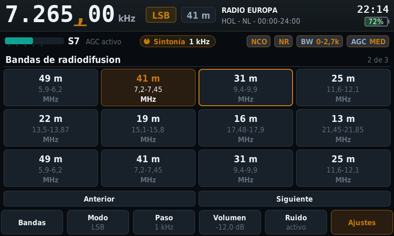

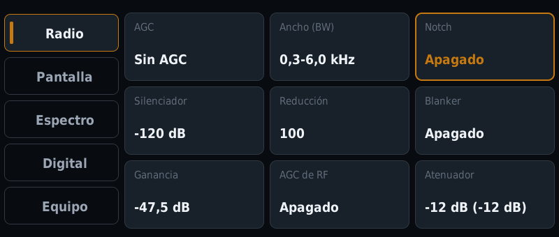

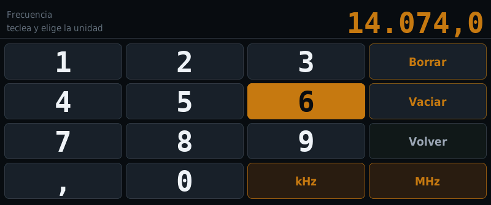

Y los **nombres de las emisoras sobre el espectro**, de la base de datos que
lleva dentro, filtrados por lo que está en antena a esa hora:

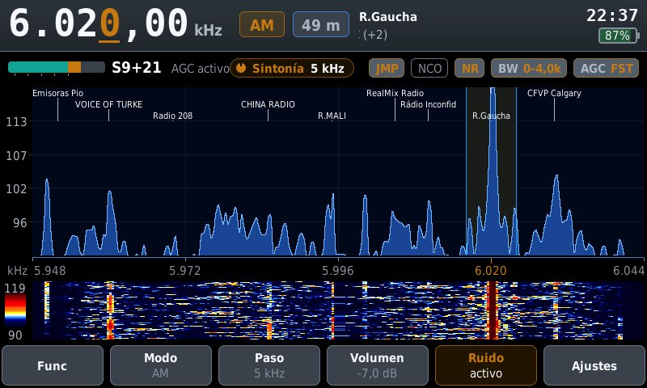

*Trece carteles en tres filas, cada uno sobre su frecuencia. Se enciende en
Ajustes → Espectro. Con **JMP** puesto, además, cada clic del mando salta a la
siguiente emisora en antena en vez de mover un paso de sintonía.*

---

## Los modos

| Familia | Modos |
|---|---|
| **Analógico** | AM · SAM · SAM-U · SAM-L · USB · LSB · NFM · WFM |
| **Digital** | CW · RTTY-L · RTTY-U · NAVTEX · APRS · PKT300 · DSC · FT8 · WSPR · AIS · ALE · PSK31 · JTTY · STANAG · IDENT |
| **Imágenes** | WEFAX · SSTV · SSTV-FM · HELL |
| **Aeronáutica** | HFDL |

Algunos detalles que no se ven en una lista:

- **CW** lleva un Goertzel solapado, un banco de nueve sondas para engancharse
  con ±250 Hz de desafine y un filtro de audio de cuatro etapas elegido
  midiendo faldas.
- **FT8** usa una ventana de 1.600 Hz (toda la banda tras el diezmado), botón
  de CQ que filtra lista y mapa, y nueve canales con su botón.
- **HFDL** trae la tabla de las 21 frecuencias con su estación, portero de
  ráfaga, base de 101.432 aviones y 356 modelos en la flash interna, y mapa.
- **El RTTY se ajusta solo**: pone los tonos encima de la señal, acierta el
  desplazamiento, mide la velocidad por la racha más corta y detecta la
  inversión. Sólo se mueve cuando lo que hay puesto va mal, y se puede apagar.
- **SSTV-FM** existe para la ISS, que manda fotos en **145,800 MHz**: el mismo
  decodificador, escuchando en FM estrecha, con el filtro de canal abierto a
  9 kHz.
- **El mapa del mundo** son 7,1 kB de costa y **cero** bytes de SRAM, con zoom,
  y puntos e indicativos de FT8, WSPR, JTTY, HFDL y AIS. Y **se puede cambiar**:
  en [`mapas/`](mapas/) hay cien, con su [catálogo de miniaturas en
  PDF](DeepSDR_mapas_100.pdf).

---

## Los mapas

La radio trae **cien mapas del mundo** para elegir, en [`mapas/`](mapas/), un
fichero `.map` por mapa. Todos ocupan lo mismo: **114.370 bytes** desde la
V5.04, que es cuando cada casilla pasó a llevar sus propios anillos de
relleno (antes eran 70.662 u 82.229, según el estilo).

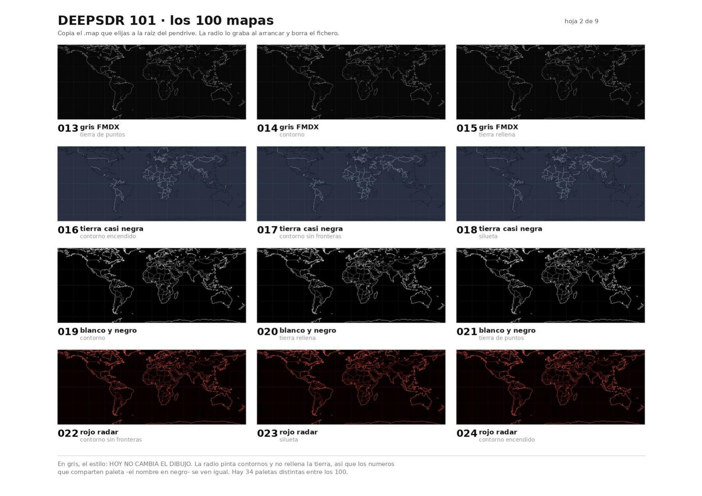

*Hoja 2 de 9 del catálogo. Las nueve están en
📄 **[DeepSDR_mapas_100.pdf](DeepSDR_mapas_100.pdf)**.*

### No es una foto, y eso es lo que lo hace posible

Lo que hay dentro del `.map` son **trazos**, no una imagen. Una foto del mundo
a la resolución de esta pantalla son 460.800 bytes, y sacarlos del bus de la
flash cuesta **370 ms por repintado** —medido, unos 100 ns por bit— cuando el
presupuesto de un fotograma son 22 ms: arrastrar el mapa iría a tres imágenes
por segundo. Y una foto no se puede ampliar: a zoom 8 el mundo mediría 32 MB y
el disco entero son 7. Con trazos, el zoom 8 se dibuja igual de limpio que el
1, ocupa cien veces menos y pintarlo cuesta lo mismo.

### Qué lleva el fichero

```
  0   "DSDRMAP1"        8 bytes, la marca
  8   versión           1
  9   niveles           1    cuántos niveles de detalle trae
 12   colores          45    quince colores, RGB de tres bytes
 60   tabla de niveles  n x 12
 ..   los trazos
 ..   suma FNV-1a       4    de todo lo anterior
```

Los quince colores son: mar, tierra, costa, frontera, rejilla, ecuador, botón,
borde, tinta, tinta apagada, marca viva, marca apagada, casa, rótulo y línea.
**Los cinco últimos son iguales en los cien mapas**, a propósito: el mapa de
FT8 tiene que verse igual que el de HFDL, así que las marcas no cambian de
color según el mapa que elijas.

Hasta la V4.77 dos mapas que sólo cambiaban de **estilo** eran el mismo
fichero byte a byte, porque la radio dibujaba contornos y no rellenaba
nunca: los cien ficheros eran sólo 34 distintos. **Desde la V4.78 el estilo
sí cambia el dibujo** —los tres estilos de relleno traen los anillos de
tierra y los tres de contorno no— y los cien son **84 distintos**. Los
anillos cuestan 47 bytes por mapa y el cierre, 22.

El relleno lo pinta la radio desde la **V4.80**: hasta entonces leía el byte
del estilo sólo al cargar el mapa desde RAM, y la radio lo carga siempre
desde su flash interna, así que no rellenaba con ninguno.

Los anillos van **fuera de la tabla de trazos**, en un mapa de bits pegado
detrás del cero que la cierra. La V4.78 los metió dentro, en un bit de la cuenta de
puntos, y eso rompía 51 de los cien ficheros en cualquier radio con firmware
anterior: el bit se colaba en la cuenta y el mapa salía como un solo trazo
gigante, sin avisar. Desde la V4.79 la tabla de trazos de un `.map` nuevo es
byte a byte la que entiende un lector viejo, así que **los mapas nuevos se
dibujan bien en cualquier versión**, sólo que sin relleno en las anteriores
a la V4.78. El banco `mapacompat` lo vigila recorriendo los cien ficheros
con los dos lectores.

### Cómo se elige

Copia **uno solo** a la raíz del disco USB de la radio y reinicia. La radio lo
graba en su flash interna con el mismo ritual que el `BD.BIN` —copiar,
comprobar la suma de lo copiado y **sólo entonces** borrarlo del disco— y te lo
dice con un cartel al arrancar. Si no copias ninguno, se queda el de serie.

En el catálogo, el nombre en negro es la **paleta** y el de abajo en gris el
**estilo**: contorno, contorno sin fronteras, contorno encendido, tierra
rellena, tierra de puntos y silueta. Los tres primeros dibujan la costa; los
tres últimos pintan la tierra con su color, **a todos los zooms desde la
V5.04**.

Hasta entonces el relleno se veía sólo a los zooms 1 y 2. Del 4 en adelante
los niveles de detalle guardan la costa **troceada por casillas**, y una
polilínea cortada no tiene «dentro»: el par‑impar no cerraba y salían rayas
horizontales. Desde la V5.04 cada casilla lleva además sus propios **anillos
cerrados**, recortados contra su rectángulo, y el relleno cierra dentro de
ella por construcción.

**Si cambias de versión, cambia también los `.map`.** Un `.map` de antes de
la V5.04 en una radio nueva dibuja bien la costa y rellena sólo a los zooms 1
y 2, como antes. Uno nuevo en una radio vieja dibuja bien la costa y no
rellena de cerca: los anillos van marcados con un bit que el firmware viejo
no mira. En ninguno de los dos casos se rompe nada; simplemente no se gana
lo nuevo. Para ponerlos al día:

```
python3 tools/mapa_pack.py tools/datos/mundo.bin tools/datos/tipos.json --salida mapas
```

Si no te gusta ninguno, `tools/mapa_pack.py` fabrica un `.map` nuevo.

---

## Cómo se instala

La radio lleva dentro un disco USB. **No hace falta abrirla ni soldar nada.**

1. Enchufa la radio al ordenador. Aparece como una unidad extraíble.
2. Si vienes del firmware de fábrica o de la rama anterior, graba **primero el
   cargador**. La aplicación de esta rama empieza en `0x08008000` y no arranca
   con el cargador viejo. **El cargador y la aplicación van juntos**: desde el
   18/10/2026 la frontera entre los dos se movió de 48 kB a 32, así que un
   `update.bin` de esta rama con un cargador anterior —o al revés— no arranca.
   Se graban los dos. El cargador se graba por DFU, que el propio chip trae
   de fábrica y sale por el mismo USB-C, **sin abrir la radio y sin soldar**:

   Para entrar en DFU: enciende la radio con el mando pulsado y girándolo, o,
   si ya tienes un firmware de esta rama, Ajustes → Equipo → Información →
   *Modo DFU* (en la página oculta, la de los cinco toques sobre Versión).
   Desde fuera parece que la radio se ha colgado —pantalla quieta, sin audio—:
   es lo normal, y se deshace apagando y encendiendo.

   <details open>
   <summary><b>· En Windows ·</b></summary>

   En Windows **no se usa `dfu-util`**: hacen falta dos cosas de GigaDevice,
   las dos en <https://www.gd32mcu.com/en/download/7?kw=GD32F4> —
   el **GD32 All-In-One Programmer** y los **GD32 Dfu Drivers**
   (versión 3.6.6.6167, `GD32DfuDrivers_V3.6.6.6167.rar`).
   **Instala primero los controladores**, antes de conectar con el programa.

   1. Con la radio en DFU, en el programador elige `USB` en **Interface** y
      `DFU` en **BootLoader**.
   2. En **Configuration → USB**, comprueba que en **Device** pone
      `GD DFU DEVICE 1`, y pulsa **Connect**. Si conecta bien, en
      *Device Information* saldrá `GD32F450VET6`, 512 KB de flash y 256 KB
      de SRAM — si sale otra cosa, para y no grabes.
   3. En la pestaña **Flash**, en *Download*, **Browse** → `customboot.bin`.
   4. Comprueba que **Start Address** dice `08000000`. Marca
      **Necessary erase** y deja puestas *Verify after download* y
      *Jump to run the App program*.
   5. **Download**, y espera a que *Process* llegue al 100 % sin errores.

   **Si al pulsar Connect te sale el botón `Remove Protection`**, esa radio
   viene con protección de lectura, y entonces esto ya no es un camino sin
   abrir nada: quitarla **borra el chip entero**, y además hay que abrir la
   radio para puentear BOOT0 a 3,3 V — desde el menú del firmware no basta.
   Está contado en la guía de instalación.

   </details>

   <details open>
   <summary><b>· En Linux ·</b></summary>

   Con `dfu-util` instalado y la radio en DFU, primero comprueba que la ve:

   ```sh
   dfu-util -l       # debe salir [28e9:0189] y una entrada alt=0, Internal Flash
   dfu-util -a 0 -s 0x08000000:leave -D customboot.bin
   ```

   La entrada `alt=1`, *Option Bytes*, aquí no se toca. Tiene que llegar al
   100 % en *Erase* y en *Download* y decir *File downloaded successfully*.

   </details>

   **No desconectes el USB ni apagues la radio mientras graba**, lo hagas
   desde donde lo hagas. Cuando termine, apaga la radio.

   Todo esto está paso a paso y **con capturas de cada pantalla** en la guía:
   📄 **[Guía de instalación (PDF, ES + EN)](INSTALL_HOWTO_EN-ES.pdf)**.
3. Copia **`update.bin`** a la raíz de esa unidad. El nombre tiene que ser
   exactamente ése: si Windows te lo guarda como `update (1).bin`, el cargador
   no lo encuentra y la radio arranca como estaba, sin decir nada.
4. Expulsa la unidad y reinicia la radio. Sale la pantalla de actualización
   con su barra de progreso.
5. Opcional: copia `BD.BIN` (emisoras y aviones) y toca **Información →
   Cargar datos**. La radio se lo lleva a su flash interna y lo borra del
   disco; que luego no esté en el disco es lo normal.

6. **Elige el mapa del mundo que quieras.** La carpeta [`mapas/`](mapas/)
   trae **cien mapas** distintos, uno por fichero `.map`. Para ver cómo es
   cada uno antes de elegir, abre el catálogo de miniaturas:
   📄 **[DeepSDR_mapas_100.pdf](DeepSDR_mapas_100.pdf)**. Copia **uno
   solo** a la raíz del disco de la radio y reinicia: la radio lo graba en su
   flash interna con el mismo ritual que el `BD.BIN` —copiar, comprobar la
   suma de lo copiado y **sólo entonces** borrarlo del disco—, y te lo dice
   con un cartel al arrancar. Si no copias ninguno, se queda el de serie.

**Si el disco no se reconoce, no lo formatees desde el ordenador.** El driver
pide sectores de 512 bytes, clúster potencia de dos que divida a 4 kB, dos
tablas y datos alineados a 4 kB, y Windows no tiene por qué elegir nada de eso.
Formatéalo desde la propia radio: Información → Formatear disco.

**Si algo sale mal:** enciende con el mando pulsado y girándolo. Entra en DFU y
se puede volver a grabar por USB.

El manual explica todo esto con más detalle, pantalla por pantalla:
📘 **[DeepSDR_Reload_Manual-ES-EN.pdf](DeepSDR_Reload_Manual-ES-EN.pdf)**.

---

## Cómo se compila

Hace falta `arm-none-eabi-gcc` y `make`. El fichero de reglas se llama
`GNUmakefile` (no `Makefile`) y las reglas largas viven en `reglas.mk`.

```sh
make update      # compila y deja update.bin listo, con su cabecera y su CRC32
make             # sólo compila
cd boot && make  # el cargador de arranque
```

`make update` no es sólo compilar: calcula la cabecera de 16 bytes con magia,
longitud y CRC32, comprueba que las **tres** direcciones base del proyecto
dicen lo mismo (enlazador, `cargador.h` y el `SCB->VTOR` de
`system_gd32f4xx.c`), vigila la pila contando el anidamiento de interrupciones
y anota la versión y el CRC en `tools/entregas.csv`.

---

## El simulador, que es la parte interesante

Está aquí dentro, en [`deepsdr-ui/`](deepsdr-ui/):

```sh
cd deepsdr-ui
make comprueba
```

**Compila los ficheros reales del firmware** —`gfx2.c`, `mapa.c`, `ui_top.c`,
los decodificadores: **los mismos ficheros que hay en `User/`**, no una copia—
con el GCC del PC, y saca PNG de 800×480. Ocho de las doce capturas de este
README salen de ahí; las otras cuatro son fotos de la radio recibiendo.

Eso da hoy **175 «TODO CORRECTO» y 0 «HAY FALLOS»** (158 si clonas el
repositorio, porque `vendor/` no se publica y los veinte bancos que lo usan se
saltan solos). Detrás hay **200 programas
de banco** y **85 comprobadores en Python** que leen el código fuente en vez de
ejecutarlo: que las tablas de modos y bandas digan lo mismo en los dos sitios,
que no haya textos sin traducir, que el manual documente lo que la radio enseña
de verdad, que ningún fichero del firmware se quede desincronizado de su copia
en el simulador.

**Dos carpetas del simulador no se publican, y no hacen falta para esa tanda:**
`vendor/` son `gfx.c` y `spectrum.c` del firmware **original** de la radio,
guardados para comparar el dibujado nuevo contra el viejo — código del
fabricante, sin licencia que invocar; y `sim/muestras/` son veinte grabaciones
de aire, parte de ellas ajenas. Los diez bancos que usan `vendor/` y los que
leen grabaciones **se lanzan a mano y no cuelgan de `make comprueba`**, así que
la tanda entera pasa sin ellas. Si lanzas uno de esos, no falla en jeroglífico:
te dice qué fichero falta y por qué no está.

Cuatro reglas del proyecto, todas aprendidas por las malas:

- **Medir contra la señal, no contra una constante.**
- **Un banco al que no se le ha visto fallar no está probado.**
- **Un banco que mide una copia miente.**
- **Un respaldo enseñado como medida no informa: engaña.**

---

## Documentación

| Fichero | Qué es |
|---|---|
| 📘 [**Manual de uso** (PDF, ES + EN)](DeepSDR_Reload_Manual-ES-EN.pdf) | El manual completo, pantalla por pantalla, en los dos idiomas. |
| [`NOVEDADES.md`](NOVEDADES.md) | Qué trae **cada versión**, en corto y en dos idiomas. |
| [`PROCEDENCIA.md`](PROCEDENCIA.md) | De dónde sale cada cosa que no es propia, fichero por fichero, y cómo encaja con la AGPL-3.0. |
| 📄 [**Guía de instalación** (PDF, ES + EN)](INSTALL_HOWTO_EN-ES.pdf) | Grabar el cargador paso a paso, con capturas, desde Windows y desde Linux. |
| 📄 [**Cambiar la flash** (PDF)](Mod%20flash%20.pdf) | Sustituir el chip de memoria por un 25Q128 para tener más disco. **Lleva soldador y es bajo tu responsabilidad.** |
| 📄 [Catálogo de los 100 mapas (PDF)](DeepSDR_mapas_100.pdf) | Las miniaturas, para elegir cuál copiar a la radio. |

---

## Mods

Nada de lo que hay en este repositorio pide abrir la radio: el firmware, el
cargador y los mapas entran todos por el USB-C. Pero hay un cambio de hardware
que merece la pena y está documentado.

### Más disco: cambiar la flash SPI

La radio trae un chip de memoria SPI pequeño, y en él viven dos cosas: el
disco que ves por USB —las capturas de pantalla, las fotos de SSTV, los mapas
del tiempo de WEFAX, tus ajustes— y la zona alta donde el firmware guarda la
base de datos de emisoras y de aviones. Cuando se llena, se llena.

**Cambiando ese chip por un 25Q128 pasas a 16 MB.** El firmware lo detecta
solo: al arrancar mide el tamaño real buscando a partir de qué dirección la
memoria «da la vuelta», así que no hay nada que configurar ni que recompilar.
Con un W25Q64 se queda en 7 MB de disco; con un 25Q128, en 15. En los dos
casos la zona alta se reserva aparte. Y 16 MB es además **todo lo que este
controlador puede usar**: por encima haría falta direccionamiento de cuatro
bytes, que no implementa.

Después del cambio hay que **formatear desde la propia radio** —Información →
Formatear disco—, no desde el ordenador: el driver pide sectores de 512 bytes,
clúster potencia de dos que divida a 4 kB, dos tablas y los datos alineados a
4 kB, y Windows no tiene por qué elegir nada de eso.

📄 **[Mod flash (PDF)](Mod%20flash%20.pdf)** — los dos pasos, con fotos:
desoldar el chip y poner el nuevo, y conectar por USB para formatear y
comprobar.

> **Esto sí lleva soldador, va sin garantía y es bajo tu responsabilidad.** Es
> un chip de montaje superficial: si no has desoldado uno antes, practica en
> otra placa. Y a diferencia de grabar el firmware, esto **no es reversible**
> salvo volviendo a soldar.

---

## Estado

```
  VERSION V6.14          CARGADOR v2.19
  update.bin  +  update_470.bin      <- 450VET6 (512 kB)  /  470VGT6 (1024 kB)
  customboot.bin  +  customboot_470.bin                   BD.BIN
  ZONA ALTA  528.384 de  847.872   libre 319.488  (294.909 aviones,
                                     220.736 emisoras, 5.592 la fuente)
  FLASH   487.916 de 491.520   libre  3.604   <- UNA region, sin desvan
  FLASH 470  487.948 de 1.015.808 libre 527.860 <- el mismo codigo, otro .ld
  CARGADOR 32.008 de  32.768   libre     760   <- DOS sectores, no tres
  RAM     193.128 de 196.608   libre   3.480   <- .bss + .data + .noinit
  RAM 470    193.128 de 458.752  libre 265.624  <- 448 kB contiguos
  TCM      58.860 de  65.536   libre   6.676   <- y eso ES la pila
  PILA      4.496 de  6.672    margen  2.176 (33%)  <- CON anidamiento
  avisos del compilador  0     comprobaciones  todas en verde
```

La RAM va al 96,2 % —7.412 bytes libres de 192 kB, los que pone la tabla—, y
ese margen es más estrecho de lo que parece: el mayor bloque suelto del
firmware ocupa 60 kB él solo, así que lo que queda no da para un modo nuevo,
da para un retoque. Cada modo de los últimos meses ha tenido que pagar su
sitio quitándoselo a otro. Los giros 6 y 7 de HFDL, por ejemplo, **no caben**
y están documentados como tal en vez de prometidos.

Los números de arriba no están escritos a mano: los saca
`tools/estado_check.py` de los `.bin` y de los dos mapas del enlazador, y
`make comprueba` falla si el README y el enlazador dejan de decir lo mismo.
Hasta el 20/10/2026 sí estaban a mano, y seis de los once renglones mentían.

Lo que falta, lo que no está probado en antena y los fallos conocidos están
anotados en el cuaderno de taller, que no se publica.

---

## Licencia y procedencia

**Este repositorio está bajo la
[GNU Affero General Public License v3](https://www.gnu.org/licenses/agpl-3.0.html)**
(AGPL-3.0) — el fichero `LICENSE` de la raíz —, que es la que lleva desde que
se abrió.

El grueso del árbol es trabajo propio, pero no todo, y antes de publicar esta
rama se repasó fichero por fichero. El inventario completo —qué es de terceros,
qué se escribió mirando una referencia ajena y qué sólo lo parece— está en
**[`PROCEDENCIA.md`](PROCEDENCIA.md)**.

El resumen:

- **`Ft8Lib/`** es [ft8_lib](https://github.com/kgoba/ft8_lib) de Kārlis Goba,
  **MIT**, copiado tal cual. Sus tablas LDPC vienen de WSJT-X, que es GPL-3.0.
- **`Firmware/`, `CMSIS/`**: biblioteca de periféricos de GigaDevice y CMSIS de
  ARM, con sus licencias.
- **La cadena de HFDL** (32 ficheros) está escrita contra
  [dumphfdl](https://github.com/szpajder/dumphfdl), **GPL-3.0-or-later**: lo
  que se confirmó contra él son parámetros de protocolo y estructura de
  algoritmo, y cada cabecera dice exactamente qué se miró.
- **El cargador de arranque no copia código del original**: los siete pines de
  placa, las tres secuencias del panel RM68120, el PWM de retroiluminación y la
  temporización del EXMC se sacaron desensamblando y comprobando, y están
  reescritos.

La AGPL-3.0 **encaja con todo lo de arriba sin tener que tocar nada**: la MIT
de `ft8_lib` es permisiva, y la propia GPLv3, en su artículo 13 («Use with the
GNU Affero General Public License»), da permiso expreso para combinar una obra
suya con una obra bajo AGPLv3 y distribuir el resultado. El inventario fichero por fichero está en
[`PROCEDENCIA.md`](PROCEDENCIA.md), e incluye lo que viene de terceros con su
licencia: `ft8_lib` (MIT), la tabla del panel RM68120 de Espressif
(Apache-2.0), el port de `libfec` del decodificador Viterbi (LGPL, Phil Karn
KA9Q), tres constantes de `liquid-dsp` (MIT) y la biblioteca de GigaDevice y
ARM. Todos con su aviso en la cabecera del fichero. Lo que quedaba pendiente
—meter el `LICENSE` de `ft8_lib` dentro de `Ft8Lib/`— **está hecho desde el
13/10/2026**.

---
---

# DEEPSDR 101 — open firmware

**Replacement firmware for the DEEPSDR 101 receiver (GD32F450VET6):** the user
interface rebuilt from the drawing engine up, twenty-eight modes, a bootloader
of its own and — the thing that holds all the rest together — **a simulator
that compiles the firmware's real code on a PC**, so that nearly every decision
in this repository was made by measuring rather than by eye.

> **This firmware is entirely free of charge and no money is made from it.
> It is also entirely reversible: anyone can flash this firmware and go back
> to the original one at any time. We do not hold or lock any device.**

`V6.14` · bootloader `v2.19` · **two builds, one per chip**:
`update.bin` 487,916 B CRC `49AEF5F4` (GD32F450VET6, 512 kB) ·
`update_470.bin` 487,948 B CRC `9CB982C5` (GD32F470VGT6, 1024 kB) ·
**275 checks green, 0 failures** (`make comprueba`)

📘 [User manual (PDF, ES + EN)](DeepSDR_Reload_Manual-ES-EN.pdf)

## What this is

The DEEPSDR 101 is an SDR receiver covering **30 kHz to 180 MHz** — medium
wave, shortwave and VHF — with an 800×480 touch screen, a QSD mixer and a
single GD32F450VET6. This is **a different firmware** for that
board: not a patch of the factory one but a tree of its own, with no RTOS and
no HAL beyond GigaDevice's standard peripheral library.

- **The interface was rebuilt from the drawing engine.** The original opened a
  panel window per pixel; this composes a 16-row band in RAM and blits it once.
  Antialiased proportional fonts, rounded corners and gradients come from that.
- **Twenty-eight modes**, from AM to STANAG, including FT8, HFDL, WSPR, AIS,
  SSTV, WEFAX, PSK31 and an IDENT mode that listens to an unknown signal and
  **tells you what it is**.
- **There is a simulator** (`deepsdr-ui/`) that compiles **the same files** as
  the firmware on a PC and writes PNGs. Not a copy: the files themselves. A
  bench that measures a copy lies.

> **This is nobody's official product and carries no warranty.** It replaces
> the radio's bootloader. There is an emergency route into DFU (power up with
> the knob held down and turning), which has already rescued the radio twice,
> but if you are not prepared for the radio to go silent, do not flash it.

## The maps

The radio ships with **a hundred world maps** to choose from, in
[`mapas/`](mapas/), one `.map` file each. They are all the same size:
**70,662 bytes**. The full thumbnail catalogue is
📄 **[DeepSDR_mapas_100.pdf](DeepSDR_mapas_100.pdf)**; sheet 2 of 9 is
[above](#los-mapas).

**It is not a photo, and that is what makes it work.** A `.map` holds
**strokes**. A photo of the world at this screen's resolution is 460,800 bytes,
and pulling them off the flash bus costs **370 ms per repaint** — measured,
about 100 ns per bit — against a 22 ms frame budget, so dragging the map would
run at three frames a second. Nor can a photo be zoomed: at zoom 8 the world
would be 32 MB and the whole disk is 7. With strokes, zoom 8 draws as cleanly
as zoom 1, takes a hundred times less room, and costs the same to paint.

The file is a `DSDRMAP1` magic, a version, the number of detail levels, fifteen
RGB colours, the level table, the strokes and an FNV-1a checksum. **The last
five colours are identical in all hundred maps**, deliberately: the FT8 map has
to look like the HFDL one, so the markers do not change colour with the map.
Measured over all hundred files: two maps with different palettes differ in
Up to V4.77 two maps differing only in **style** were the same file byte for
byte, because the radio drew outlines and never filled: the hundred files
were only 34 distinct ones, differing in **49 bytes out of 70,662** — the
45-byte colour block plus the 4-byte checksum. **Since V4.78 the style does
change the drawing** — the three filling styles carry land rings and the
three contour ones do not — and the hundred are **84 distinct**. The rings
cost 47 bytes per map, and closing them 22.

The radio has painted the fill since **V4.80**: before that it read the style
byte only when loading a map from RAM, and the radio always loads from its
internal flash, so it filled with none of them.

The rings live **outside the stroke table**, in a bitmap tucked behind the
zero that closes it. V4.78 put them inside, in a bit of the point count, and that
broke 51 of the hundred files on any radio running an earlier firmware: the
bit leaked into the count and the map came out as one giant stroke, silently.
Since V4.79 a new `.map`'s stroke table is byte for byte what an old reader
expects, so **new maps draw correctly on any version** — just without the
fill below V4.78. The `mapacompat` bench guards this by walking all hundred
files with both readers.

**To pick one:** copy a single `.map` to the root of the radio's USB disk and
restart. The radio burns it into internal flash with the same ritual as
`BD.BIN` — copy, verify the checksum of what was copied, and **only then**
delete it from the disk — and says so on screen while booting. Copy none and
the built-in map stays.

On the catalogue, the name in black is the palette and the grey line under it
is the style: outline, outline without borders, lit outline, filled land,
dotted land and silhouette. The first three draw the coast; the last three
paint the land in its own colour. **The fill shows at zoom 1 and 2**; from 4
up the outline comes back, because the detail levels store the coast cut into
tiles and a split ring no longer closes. It is 1 and 2 — not just 1 — because
the levels are x1, x4 and x8: zoom 2 is drawn by stretching x1, which is the
one carrying the rings.

If your `.map` files predate V4.78 they draw as they always did, without
fill: they carry zero in the style byte, which means outline. To bring them
up to date: `python3 tools/mapa_pack.py tools/datos/mundo.bin
tools/datos/tipos.json --salida mapas`. The other direction works too: a
V4.79 `.map` on an older radio draws the coast correctly and skips the fill.

If none of them suits, `tools/mapa_pack.py` builds a new `.map`.

---

## Installing

The radio exposes a USB disk. **No need to open it or to solder anything.**

1. Plug the radio into a computer; it shows up as a removable drive.
2. Coming from the factory firmware or from the previous branch, **flash the
   bootloader first**. This branch's application starts at `0x08008000` and
   will not boot under the old loader. **Loader and application go together**:
   since 18/10/2026 the boundary between them moved from 48 KB down to 32, so
   an `update.bin` from this branch under an older loader — or the other way
   round — will not boot. Flash both. The loader goes in over DFU, which the
   chip provides in ROM over the same USB-C — **no opening the radio, no
   soldering**:

   To enter DFU: power up with the knob held down and turning, or, if you
   already run this branch, Settings → Device → Information → *DFU mode* (on
   the hidden page, five taps on the Version row). From outside the radio looks
   frozen — still screen, no audio. That is normal; power-cycling undoes it.

   <details open>
   <summary><b>· On Windows ·</b></summary>

   Windows does **not** use `dfu-util`. You need two things from GigaDevice,
   both at <https://www.gd32mcu.com/en/download/7?kw=GD32F4> — the
   **GD32 All-In-One Programmer** and the **GD32 Dfu Drivers**
   (version 3.6.6.6167, `GD32DfuDrivers_V3.6.6.6167.rar`).
   **Install the drivers first**, before connecting with the programmer.

   1. With the radio in DFU, set **Interface** to `USB` and **BootLoader**
      to `DFU`.
   2. Under **Configuration → USB**, check that **Device** reads
      `GD DFU DEVICE 1`, then press **Connect**. On a good connection
      *Device Information* shows `GD32F450VET6`, 512 KB flash, 256 KB SRAM —
      if it shows anything else, stop and do not flash.
   3. On the **Flash** tab, under *Download*, **Browse** → `customboot.bin`.
   4. Check that **Start Address** reads `08000000`. Tick
      **Necessary erase**, and leave *Verify after download* and
      *Jump to run the App program* on.
   5. Press **Download** and wait for *Process* to reach 100 % with no errors.

   **If pressing Connect shows a `Remove Protection` button**, that radio has
   read protection, and from here on this is no longer a no-disassembly path:
   clearing it **erases the whole chip**, and you then have to open the radio
   to strap BOOT0 to 3.3 V — the firmware menu is not enough. The installation
   guide covers it.

   </details>

   <details open>
   <summary><b>· On Linux ·</b></summary>

   With `dfu-util` installed and the radio in DFU, check it is seen first:

   ```sh
   dfu-util -l       # expect [28e9:0189] and an alt=0 entry, Internal Flash
   dfu-util -a 0 -s 0x08000000:leave -D customboot.bin
   ```

   The `alt=1` *Option Bytes* entry is not touched here. *Erase* and
   *Download* must both reach 100 % and end in *File downloaded successfully*.

   </details>

   **Do not unplug the USB or switch the radio off while it is flashing**,
   whichever route you took. Switch the radio off when it finishes.

   All of this is step by step and **with a screenshot of every screen** in
   📄 **[the installation guide (PDF, ES + EN)](INSTALL_HOWTO_EN-ES.pdf)**.
3. Copy **`update.bin`** to the root of that drive. The name must be exactly
   that: if Windows saves it as `update (1).bin` the loader will not find it
   and the radio boots unchanged, silently.
4. Eject and restart the radio. The update screen appears with its progress bar.
5. Optional: copy `BD.BIN` (stations and aircraft) and tap **Information →
   Load data**. The radio moves it into its internal flash and deletes it from
   the disk — it being gone afterwards is normal.

6. **Pick the world map you want.** [`mapas/`](mapas/) holds **a hundred**
   of them, one per `.map` file; the thumbnail catalogue is
   📄 **[DeepSDR_mapas_100.pdf](DeepSDR_mapas_100.pdf)**. Copy **one**
   to the root of the radio's disk and restart: the radio burns it into its
   internal flash with the same ritual as `BD.BIN` — copy, verify the
   checksum of what was copied, and **only then** delete it from the disk —
   and says so on screen while booting. Copy none and the built-in map stays.

**If the disk is not recognised, do not format it from the computer.** The
driver needs 512-byte sectors, a power-of-two cluster dividing the 4 kB erase,
two FATs and the data area aligned to 4 kB, and Windows has no reason to pick
any of that. Format from the radio itself: Information → Format disk.

**If something goes wrong:** power up with the knob held down and turning. That
enters DFU and the radio can be reflashed over USB.

## Building

You need `arm-none-eabi-gcc` and `make`. The rules file is called `GNUmakefile`
(not `Makefile`); the long rules live in `reglas.mk`.

```sh
make update      # builds and leaves update.bin ready, header and CRC32 included
make             # build only
cd boot && make  # the bootloader
```

## The simulator

It lives here, in [`deepsdr-ui/`](deepsdr-ui/):

```sh
cd deepsdr-ui
make comprueba
```

It compiles **the firmware's real files** — `gfx2.c`, `mapa.c`, `ui_top.c`, the
decoders: **the very files in `User/`**, not a copy — with the host GCC, and
writes 800×480 PNGs. Eight of this README's twelve screenshots come from it;
the other four are photographs of the radio receiving.

That prints **175 "TODO CORRECTO" (158 si clonas sin `vendor/`) and 0 "HAY FALLOS"** today. Behind it are
**200 bench programs** and **85 Python checkers** that read the source instead
of running it: that the mode and band tables agree in both places, that no
string is left untranslated, that the manual documents what the radio actually
shows, that no firmware file has drifted from its copy in the simulator.

**Two of the simulator's folders are not published, and that tally does not
need them:** `vendor/` holds `gfx.c` and `spectrum.c` from the radio's
**original** firmware, kept to compare the new drawing against the old — the
manufacturer's code, with no licence to invoke; and `sim/muestras/` holds
twenty off-air recordings, some of them other people's. The ten benches that
use `vendor/` and the ones that read recordings **are run by hand and do not
hang off `make comprueba`**, so the whole run passes without them. Run one of
those and it does not fail in hieroglyphics: it names the missing file and says
why it is not there.

Four rules of this project, all learned the hard way:

- **Measure against the signal, not against a constant.**
- **A bench that has never been seen to fail has not been tested.**
- **A bench that measures a copy lies.**
- **A fallback shown as a measurement is not informing, it is lying.**

## Documentation

| File | What it is |
|---|---|
| 📘 [**User manual** (PDF, ES + EN)](DeepSDR_Reload_Manual-ES-EN.pdf) | The full manual, screen by screen, in both languages. |
| [`NOVEDADES.md`](NOVEDADES.md) | What each **version** brings, short, in both languages. |
| [`PROCEDENCIA.md`](PROCEDENCIA.md) | Where everything that is not original comes from, file by file, and how it fits the AGPL-3.0. In Spanish. |
| 📄 [**Installation guide** (PDF, ES + EN)](INSTALL_HOWTO_EN-ES.pdf) | Flashing the bootloader step by step, with screenshots, on Windows and on Linux. |
| 📄 [**Flash memory mod** (PDF)](Mod%20flash%20.pdf) | Replacing the memory chip with a 25Q128 for more disk. **Soldering required, at your own risk.** |
| 📄 [100-map catalogue (PDF)](DeepSDR_mapas_100.pdf) | The thumbnails, to pick which one to copy to the radio. |

---

## Mods

Nothing in this repository requires opening the radio: firmware, bootloader
and maps all go in over USB-C. But there is one hardware change worth making,
and it is documented.

### More disk: replacing the SPI flash

The radio ships with a small SPI memory chip, and it holds two things: the
disk you see over USB — screenshots, SSTV pictures, WEFAX weather charts, your
settings — and the high area where the firmware keeps the station and aircraft
database. When it fills up, it fills up.

**Swap that chip for a 25Q128 and you get 16 MB.** The firmware works it out
by itself: at boot it measures the real size by finding the address at which
the memory wraps around, so there is nothing to configure and nothing to
rebuild. A W25Q64 gives 7 MB of disk; a 25Q128 gives 15. Either way the high
area is reserved separately. And 16 MB is **everything this controller can
use**: beyond that it would need four-byte addressing, which it does not
implement.

After the swap, **format from the radio itself** — Information → Format disk —
and not from the computer: the driver needs 512-byte sectors, a power-of-two
cluster dividing the 4 kB erase, two FATs and the data area aligned to 4 kB,
and Windows has no reason to pick any of that.

📄 **[Flash mod (PDF)](Mod%20flash%20.pdf)** — the two steps, with photos:
desolder the chip and fit the new one, then connect over USB to format and
verify.

> **This one does need a soldering iron, comes with no warranty and is at your
> own risk.** It is a surface-mount chip: if you have never desoldered one,
> practise on another board first. And unlike flashing the firmware, this is
> **not reversible** except by soldering again.

---

## Licence and provenance

**This repository is under the
[GNU Affero General Public License v3](https://www.gnu.org/licenses/agpl-3.0.html)**
(AGPL-3.0) — the `LICENSE` file at the root — which is what it has carried
since it was opened.

Most of the tree is original work, but not all of it, and it was reviewed file
by file before publishing this branch. The full inventory — what is third-party, what was
written while reading someone else's reference, and what only looks like either
— is in **[`PROCEDENCIA.md`](PROCEDENCIA.md)** (in Spanish).

In short: `Ft8Lib/` is [ft8_lib](https://github.com/kgoba/ft8_lib) by Kārlis
Goba (MIT), vendored as is, and its LDPC tables come from WSJT-X (GPL-3.0);
`Firmware/` and `CMSIS/` are GigaDevice's and ARM's; the HFDL chain (32 files)
was written against [dumphfdl](https://github.com/szpajder/dumphfdl)
(GPL-3.0-or-later), with each header stating exactly what was checked against
it; and the bootloader copies no code from the original one.

AGPL-3.0 fits all of that without changing a line: `ft8_lib`'s MIT is
permissive, and GPLv3 itself, in its section 13 ("Use with the GNU Affero
General Public License"), expressly allows combining a GPLv3 work with an
AGPLv3 one and conveying the result. What is left is paperwork, noted in
[`PROCEDENCIA.md`](PROCEDENCIA.md): put `ft8_lib`'s `LICENSE` inside
`Ft8Lib/`, since MIT asks that the notice travel with the code.
